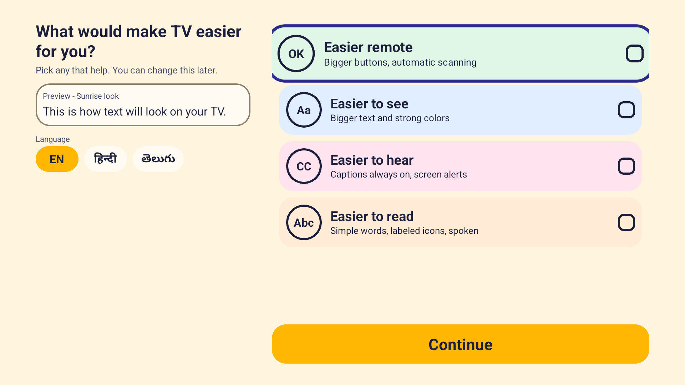
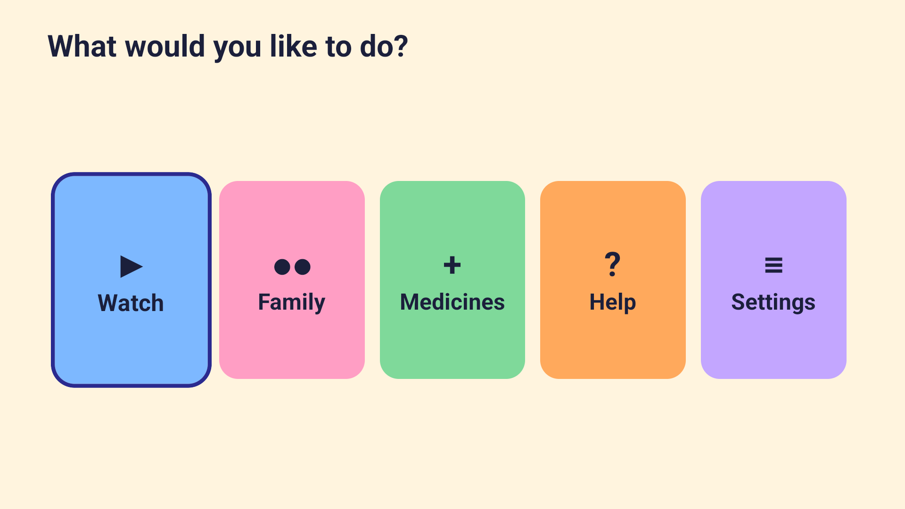
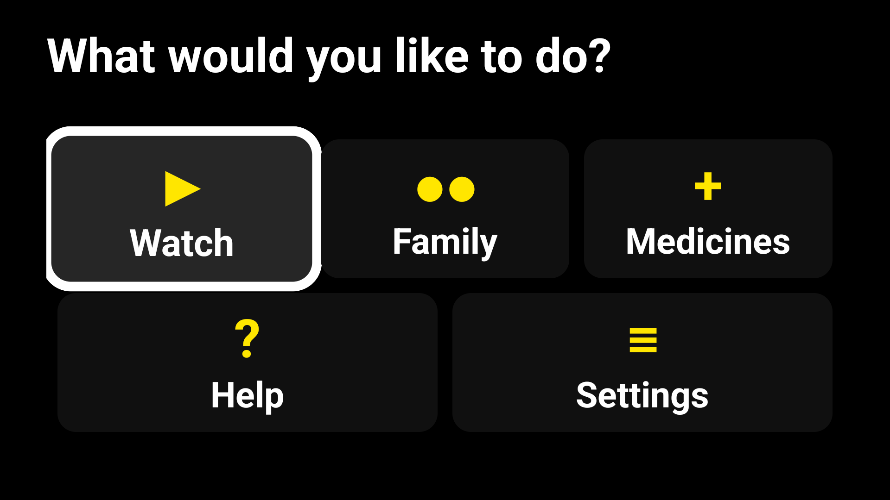
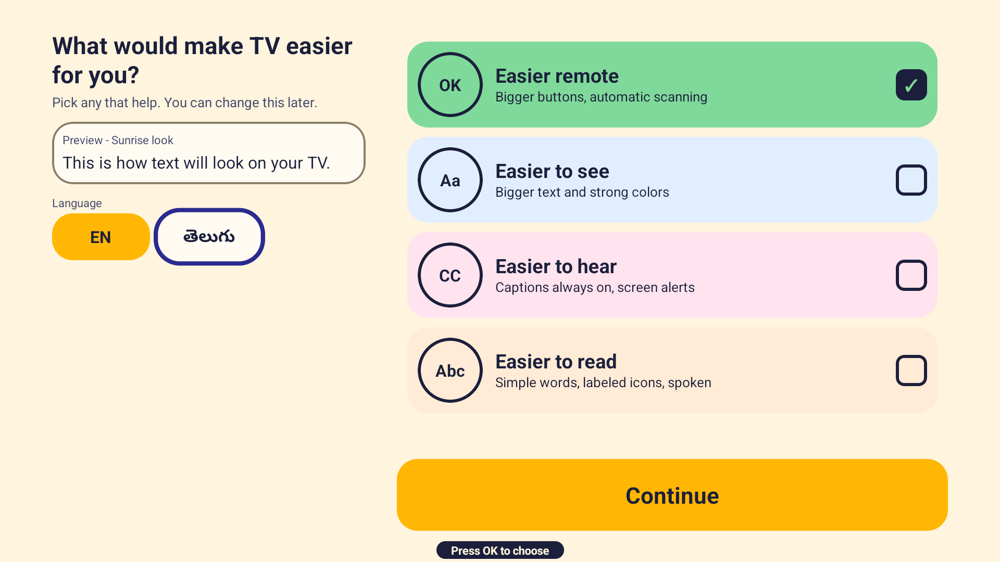
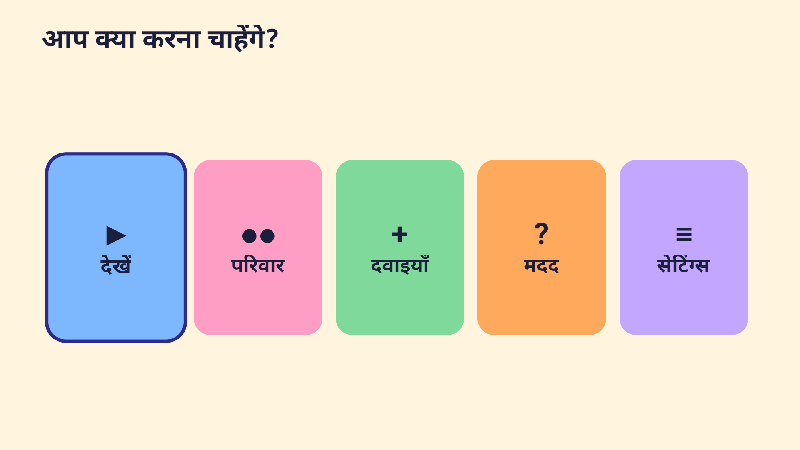
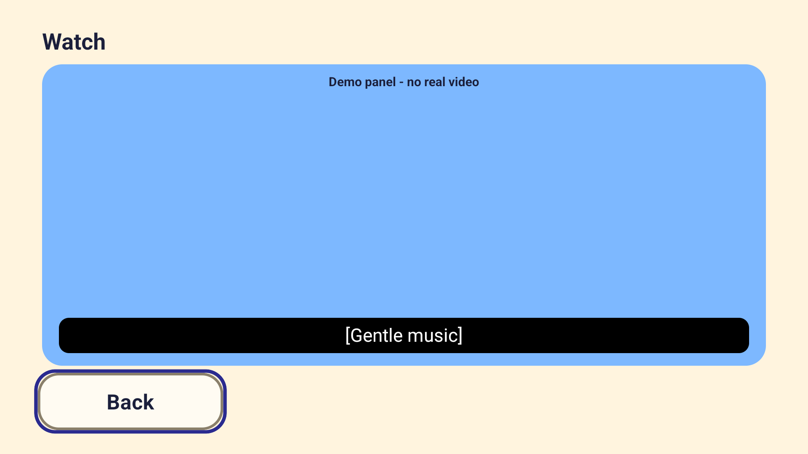
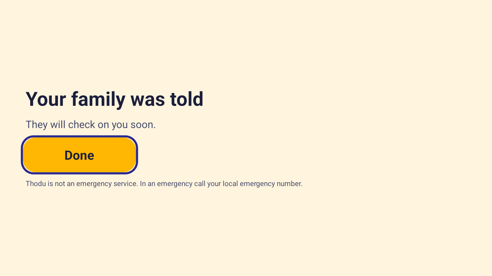
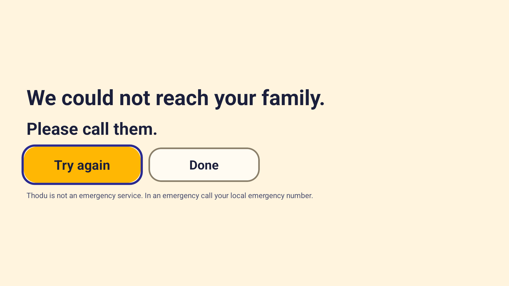

# Thodu

**Thodu — the TV that adapts to you.**

Thodu (తోడు) means "a companion by your side" in Telugu.

An accessibility-first Android TV / Fire TV app (React Native + Expo). It was built for the Amazon developer hackathon and is a working prototype, not a finished product. Reviewers: start with [JUDGES.md](JUDGES.md).

> **Thodu is not an emergency service. In an emergency call your local emergency number.**

## The problem

Many older viewers and viewers with disabilities find a TV remote, small text and dense menus hard to use. Typical difficulties are reading small or low-contrast text, hearing the sound, pressing many small remote buttons, and following long menus. Thodu starts from the person's needs instead of from a settings menu.

## What Thodu does

- **Needs-based setup.** The first screen asks "What would make TV easier for you?" with four large choices (easier remote, easier to see, easier to hear, easier to read). The choices are turned into settings by one pure function (`packages/shared/src/core/adapt.ts`).
- **Live adaptation preview.** While choosing, the whole setup screen restyles immediately (text size, colours, focus ring, button size).
- **Single-button scanning.** With "easier remote", the app highlights one item at a time (every 1.8 s by default) and a single OK press selects it, so the app can be used with one button.
- **Large text and high contrast.** Text scale up to 1.6x, a black-and-yellow high-contrast theme, and a thick focus ring. The default "Sunrise" theme is colourful with one colour per tile.
- **Read-aloud and screen-reader support.** With read-aloud on, focused items are spoken with Android text-to-speech; if a screen reader is on, the app announces through it instead and suggests needs ("Choose them for me") without applying anything by itself.
- **Captions demo.** With "easier to hear" chosen, the Watch screen is a demo panel (no real video) with a looping caption bar; without it, Watch is a placeholder screen.
- **Visual alerts.** When "easier to hear" is chosen, the help confirmation shows a flashing "ALERT SENT" banner.
- **Simple language and labelled buttons.** "Easier to read" also switches about 40 key strings per language to shorter, plainer wording (`core/simpleText.ts`; strings without a simple variant stay as they are) and adds a text glyph next to the label of every action button. The glyphs are plain characters (no emoji, no images) and the text label is always kept. Hindi and Telugu simple wording has not been reviewed by native speakers.
- **English, Hindi, Telugu.** Language chips on the setup screen. Hindi and Telugu need review by native speakers (see Limitations).
- **Persistence.** Needs, language, scanning speed and the family settings are saved on the device; the next launch goes straight to Home. "Reset Thodu" clears them.
- **Real family notification (optional).** "Tell my family" can send one short, generic message through the free [ntfy.sh](https://ntfy.sh) service to a phone that has the ntfy app. There is no Thodu server. Until a test message has succeeded, the Help button is clearly labelled as a demo, and failures are shown honestly ("We could not reach your family. Please call them.").

## How your needs change the app

From `packages/shared/src/core/adapt.ts` (tested in `adapt.test.ts`). Needs combine by taking the larger number or the OR of the on/off settings.

| Need chosen | Settings changed |
|---|---|
| Easier to see (low vision) | text scale 1.6x, high-contrast theme, focus ring width 10 (default 4), larger buttons |
| Easier to hear (hard of hearing) | captions always on, visual alerts on |
| Easier remote (remote difficulty) | single-button scanning on (1800 ms per item), larger buttons |
| Easier to read (reading difficulty) | read-aloud on; simple language on (shorter wording for the key strings on Setup, Home, Help, Family and Settings, in English, Hindi and Telugu); icons with labels on (every action button such as Back, Continue, Try again, Tell my family, Cancel and Send a test shows a glyph next to its text; home tiles always show a glyph and a label) |

Nothing chosen = default settings (text 1.0x, ring 4, everything else off).

## Screenshots

All screenshots are from an Android TV **emulator** (Android 14, 1920x1080).

| | |
|---|---|
|  Needs-based setup |  Home, default Sunrise theme |
|  High-contrast, large text, larger tiles |  Scanning mode highlight and hint |
|  Home in Hindi |  Watch screen: demo panel with caption bar |
|  Help sent (real mode, ntfy answered 2xx) |  Help failed (offline simulated on the emulator) |

## Real vs simulated

| Part | Status |
|---|---|
| Family notification through ntfy.sh | **Real** HTTPS request; success is shown only when ntfy.sh answers with HTTP 2xx. We did **not** subscribe a phone during development, so delivery to a real phone is not yet verified. |
| "Family phone" card on the Family screen | **Simulated** preview (labelled "Simulated" in the app) |
| Help flow before a test message succeeded | **Demo** (labelled "DEMO - simulated notification") |
| Watch screen and captions | **Demo panel**, no real video, scripted captions |
| Offline / failure screen | Verified by simulating a lost network on the emulator (`adb emu network delay`); other real-world failures use the same error handling but were not each tried |
| Cold-start numbers | Measured on an **emulator** only |
| Accessibility label audit | Self-run with uiautomator on the emulator |
| Screen reader (VoiceView / TalkBack) | Detection and routing implemented and unit-tested; **not tested on a real device or with a screen reader running** |
| Read-aloud speech | English voice observed on the emulator; Hindi and Telugu voices **not verified** |
| Hindi and Telugu text | Written by the developer; **need native-speaker review** |
| Real Fire TV hardware | **Not tested** (emulator only) |
| Medicines screen | Placeholder only |

## Claims and evidence

| Claim | Evidence |
|---|---|
| Needs map to settings as in the table above | `packages/shared/src/core/__tests__/adapt.test.ts` (12 tests) |
| Text and focus colours meet WCAG AA contrast (AAA for labels in high contrast) by calculation | `core/__tests__/theme.test.ts` (65 checks over every text/background pair), `core/contrast.ts` |
| Scanning moves through items on a timer and OK selects | `core/__tests__/scanner.test.ts` (16 tests); an adb run using only ENTER and BACK keys reached the help flow (developer's key log, not committed) |
| Settings survive restart; corrupt data falls back to safe defaults | `core/__tests__/persist.test.ts`; on the emulator, force-stop and relaunch went straight to Home in Hindi |
| ntfy client: topic generation, payload, retry, never throws, success only on 2xx | `core/__tests__/notify.test.ts` (27 tests, network injected, no real requests) |
| The notification text is generic | `buildPayload` in `core/notify.ts` |
| English, Hindi and Telugu have the same keys | `core/__tests__/strings.test.ts` |
| System font scale is capped at 1.3x and the total at 2.0x | `core/a11y.ts`, `core/__tests__/a11y.test.ts` |
| Every interactive element has a name (35 nodes, 0 unlabeled) | `tools/a11y-audit.mjs` (uiautomator on the emulator); numbers below |
| App asks only for INTERNET and network-state permissions, no cleartext, no backup | [SECURITY.md](SECURITY.md); `packages/expotv/app.json` |
| The emergency disclaimer is shown on help screens | Screenshots 07 and 08; `core/strings/en.ts` |

## Tests

186 unit tests in 12 suites, all passing in the latest run (Jest, pure logic in `packages/shared/src/core`, no device needed):

```bash
cd packages/shared
npx jest -c jest.core.config.js        # or: yarn test  (from the repo root)
```

Suites: theme 65, notify 27, persist 18, scanner 16, simpleText 13, adapt 12, a11y 9, strings 8, helpEvents 7, speech 4, captions 4, buttonIcons 3. The screens themselves have no automated UI tests; they were checked by hand on the emulator.

## Measured numbers (emulator only)

- **Cold start** (Google AOSP TV, x86 emulator, Android 14, release build, 7 runs after force-stop, `am start -W`): min 1136 ms, median 1351 ms, max 1965 ms. Not a Fire TV Stick number.
- **Label audit** (uiautomator, 9 screens): 35 interactive nodes, 0 without a text or content description. This checks that names exist, not that they sound right.

Tools: `tools/cold-start.mjs`, `tools/a11y-audit.mjs`, `tools/security-check.mjs` (set `ANDROID_HOME` to your SDK folder).

## Setup and run on Windows

These are the steps that worked for us. Prerequisites and the versions we used:

- Windows 11, Node.js 24, Yarn 4.5.0 (we ran it through `npx @yarnpkg/cli-dist@4.5.0`)
- **JDK 17** (Eclipse Temurin 17). Android Studio's bundled JDK 25 failed in the Android Gradle plugin prefab step.
- Android SDK with an Android TV system image (we used API 34, x86, from an Android Studio install)
- Expo SDK 55, react-native-tvos 0.83.6-0, Gradle 9.0.0 (downloaded by the build)
- **A short repo path** (about 15 characters or fewer). Longer paths made the native build fail with "Filename longer than 260 characters", even with Windows long paths enabled.

```bash
# 1. dependencies (repo root)
yarn workspaces focus @thodu/expotv

# 2. generate the native Android project (sets EXPO_TV=1)
yarn expotv:prebuild

# 3. release build with JAVA_HOME pointing at JDK 17 (JS bundle is embedded, no Metro needed)
#    x86 emulator image: first add reactNativeArchitectures=x86 to
#    packages/expotv/android/gradle.properties (the android/ folder is generated, not committed)
cd packages/expotv/android
./gradlew assembleRelease

# 4. install and launch on a running emulator
adb install -r app/build/outputs/apk/release/app-release.apk
adb shell monkey -p com.thodu.tv -c android.intent.category.LEANBACK_LAUNCHER 1
```

Notes: the first release build took about 19 minutes on our low-memory PC (x86 only); later builds after JS-only changes took about 1 to 3 minutes. After editing JS in `packages/shared`, run the Gradle task `:app:createBundleReleaseJsAndAssets --rerun` or Gradle may ship stale JavaScript. Our list of tool problems is in [docs/FRICTION_LOG.md](docs/FRICTION_LOG.md). The release build is signed with the debug keystore, which is fine for a demo only.

## Architecture

- Yarn 4 workspaces monorepo: `packages/expotv` (the Expo TV app shell, routes in `app/`) and `packages/shared` (all app code).
- `packages/shared/src/core`: pure TypeScript logic with no React Native imports, so it is unit-tested with Jest: needs to settings (`adapt.ts`), themes and contrast (`theme.ts`, `contrast.ts`), scanner state machine (`scanner.ts`), persistence (`persist.ts`), ntfy client (`notify.ts`), screen-reader and font-scale rules (`a11y.ts`, `speech.ts`), strings in `en`, `hi`, `te`.
- `packages/shared/src/settings`: provider that holds settings and loads and saves them with AsyncStorage (injected as a storage interface).
- `packages/shared/src/scan`: `ScanScope` runs the scanner over every focusable item on a screen, with one invisible focus-sink view because Android only delivers remote keys while some view has focus.
- `packages/shared/src/components` and `screens`: focusable buttons, text wrapper, setup, home, help flow, family settings, watch demo.
- Notification path: Help screen -> `sendHelp` (HTTPS POST to ntfy.sh, 8 s timeout, one retry) -> result shown honestly. No backend, no analytics, no accounts.
- Navigation: expo-router stack; the remote Back button pops the stack, and on Home it leaves the app.

## Limitations and known issues

- Telugu and Hindi strings were written by the developer and have not been reviewed by native speakers. Telugu and Hindi speech voices were not checked.
- Everything was run on an emulator. No real Fire TV, no real screen reader, no real family phone, and no sessions with real users yet.
- ntfy.sh is a public service: anyone who knows the topic name can read or post messages. The name is random but should be treated as a shared secret.
- The help log is kept in memory only. Medicines is a placeholder. Watch is a demo.
- Back on Home exits to the launcher.
- Release builds use the debug keystore. The dependency audit lists 108 advisories (see SECURITY.md); we have not upgraded dependencies.
- Sample code from the Amazon starter remains in `packages/expotv` (components, layouts, hooks, constants) but is not used by the app.
- Scanning was proven by an adb run on an earlier build; it was not re-run on every later build.

## Roadmap

Voice trigger through Alexa+ for people who cannot use a remote (not built).

## Credits and license

The app icon, launcher banner and splash mark are original artwork made for Thodu (SVG sources in `assets/branding/`, rendered with `tools/make-branding.mjs`); no third-party logos or images are used.

MIT, see [LICENSE](LICENSE). Thodu started from Amazon's [react-native-multi-tv-helloworld](https://github.com/AmazonAppDev/react-native-multi-tv-helloworld) sample (MIT-0); credits are in [NOTICE](NOTICE). Other docs: [SECURITY.md](SECURITY.md), [ACCESSIBILITY.md](ACCESSIBILITY.md), [JUDGES.md](JUDGES.md), [docs/FRICTION_LOG.md](docs/FRICTION_LOG.md).

**Thodu is not an emergency service. In an emergency call your local emergency number.**
