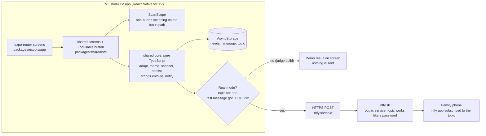

# Thodu TV (తోడు టీవీ)

**A TV built for elderly and disabled people that calls the family for help**

*Built for one person, made for many.* (Thodu means "companion" in Telugu.)

**[Demo video (about 2:20)]([VIDEO_URL])** · **[Judge guide: 5 minutes with the APK](docs/JUDGES.md)** · **[Release: the judge APK](https://github.com/survivepathuri/thodu-tv/releases)**

> **Thodu TV is not an emergency service and not a medical device. In an emergency call your local emergency number.**

Thodu TV is a Fire TV track entry for the Amazon "Build, Ship, Shape" hackathon. It is a working prototype, not a finished product. It is a React Native for TV app (Expo prebuild, `react-native-tvos`), started on 2026-10-12 from Amazon's MIT-0 sample `react-native-multi-tv-helloworld`; nothing existed before the Submission Period began on 2026-08-31 ([docs/PRE_EXISTING.md](docs/PRE_EXISTING.md)).

## What it does

1. **First run asks one question:** "What would make TV easier for you?" Four large choices restyle the whole app live and can be combined: **Easier to see** (text 1.6x, black/white/yellow high-contrast theme, thick focus ring, larger buttons), **Easier to hear** (captions on in the Watch demo, a flashing visual banner after Help), **Easier remote** (automatic one-button scanning: one item is highlighted at a time and OK chooses it), **Easier to read** (read-aloud, simpler wording, a glyph on every action button). English, Hindi and Telugu.
2. **Home has five tiles:** Watch (a labelled demo panel, no real video), Family, Medicines (a one-press "Yes, I took it" check-in, no reminders), Help, Settings.
3. **Help asks once to confirm, then notifies the family** through the free [ntfy](https://ntfy.sh) app on their phone. With no private topic set up (the judge build), the app runs in **demo mode**: it says "This is only a demo. No one has been contacted." and sends nothing.

## How to check it, by judging criterion

The Devpost criteria are Tech Implementation, Design, Potential Impact and Quality of the Idea, plus the repository requirements and the optional feedback and friction log. One thing to open or run for each:

| Criterion | Verify with | What you should see |
|---|---|---|
| Stage One: fits the theme and runs on Fire OS | [docs/DEVICE_EVIDENCE.md](docs/DEVICE_EVIDENCE.md) | An Android-based app with a leanback launcher that ran on an Amazon Fire TV cloud device. It uses no Amazon-specific API and no Vega SDK (the Fire TV track accepts any framework that runs on Fire OS) |
| Tech Implementation | `cd packages/shared && npx jest -c jest.core.config.js` | **16 suites, 223 tests, all passing**; architecture below |
| Design (usable by the target viewer) | `node tools/a11y-measure.mjs` and [docs/ACCESSIBILITY.md](docs/ACCESSIBILITY.md) | 73 colour pairs in both themes, 0 below target; lowest text contrast 7.79:1; smallest text 22 design px; 25 of 25 focusable elements labelled |
| Potential Impact (credible, specific case) | [docs/SOURCES.md](docs/SOURCES.md), [docs/USER_TESTING.md](docs/USER_TESTING.md) | Cited WHO and Government of India figures; one consented family session (n = 1, an anecdote, not evidence of benefit) |
| Quality of the Idea | [docs/JUDGES.md](docs/JUDGES.md) steps 1 to 6 | Needs-based setup, one-button scanning and a family alert in one app |
| Repository: open-source license | [LICENSE](LICENSE) | MIT (Amazon's MIT-0 sample text is kept in [NOTICE](NOTICE)) |
| Repository: setup and run instructions | "Install and run" below, [docs/JUDGES.md](docs/JUDGES.md) | Sideload the APK or build from source |
| Pre-existing work | [docs/PRE_EXISTING.md](docs/PRE_EXISTING.md) | First commit 2026-10-12, after 2026-08-31 |
| Product Feedback | [docs/PRODUCT_FEEDBACK.md](docs/PRODUCT_FEEDBACK.md) | 13 entries in five elements each |
| Friction log (optional) | [docs/FRICTION_LOG.md](docs/FRICTION_LOG.md) | 11 curated entries, Amazon first; 35 detailed entries in [FRICTION_LOG.md](FRICTION_LOG.md) |

Every claim and its evidence tag: [docs/CLAIMS.md](docs/CLAIMS.md).

## Install and run in under 2 minutes

**Judge APK** (from the Release page, file `thodu-tv-d52f5fe-judge.apk`, 68,382,021 bytes). Check it first:

```bash
sha256sum thodu-tv-d52f5fe-judge.apk     # expect 6e1ef0ac79f3eda694f65e63b9234baf01b53c845cb6c41ecff55f3daea4331f
```

- **Fire TV or Android TV with adb:** turn on ADB debugging and "Apps from unknown sources" in the TV's developer options, then

  ```bash
  adb connect <tv-ip>:5555
  adb install -r thodu-tv-d52f5fe-judge.apk
  adb shell monkey -p com.thodu.tv -c android.intent.category.LEANBACK_LAUNCHER 1
  ```

- **Fire TV with the Downloader app:** open the Release page's APK link in Downloader (or type the link shown on the Release page), install, then open Thodu TV from Apps.
- **No TV at hand:** Amazon Developer Console > Appstore Quality Central > Live Device Interaction, upload the APK to a cloud Fire TV.
- **Then:** choose "Easier remote", Continue, open Help > Tell my family: you see the labelled demo result. More steps: [docs/JUDGES.md](docs/JUDGES.md), [docs/INSTALL_ON_TV.md](docs/INSTALL_ON_TV.md).

**No device?** Run the tests and the accessibility script (below); they need only Node.

## Architecture

Checked against the code (`packages/shared/src`, `packages/expotv/app`):



- `packages/shared/src/core` has no React Native imports, so Jest tests it. `notify.ts` is the one sender behind Help, Family and Medicines: HTTPS POST, 8 s timeout, one retry for network errors, timeouts, 5xx and 429, a 3 s debounce, and "sent" only on an HTTP 2xx.
- Real mode needs a topic plus one successful test message from Settings > Family notifications. There is no Thodu TV server, no account and no analytics.
- Navigation is an expo-router stack; Back pops the stack and on Home leaves the app.

## What is real, simulated, and not built yet

Status words: **VERIFIED** = the author or a script ran it and the evidence is named; **UNVERIFIED** = built but not seen working; **SIMULATED** = it looks real on screen but is a stand-in; **NOT** = not built or not done. Evidence tags are defined in [docs/DEVICE_EVIDENCE.md](docs/DEVICE_EVIDENCE.md).

| Part | Status | Evidence |
|---|---|---|
| Needs to settings, themes, scanner state machine, persistence, strings, notification sender | VERIFIED by 223 unit tests in 16 suites (run 2026-10-23) | `[unit test]` |
| Contrast, text sizes, label coverage | VERIFIED by script | `[script]` `node tools/a11y-measure.mjs` |
| Judge APK facts: 68,382,021 bytes, SHA-256 `6e1ef0ac...ea4331f`, `versionName` `1.0.0+d52f5fe-judge`, minSdk 24 / targetSdk 36, leanback launcher, no topic string | VERIFIED on 2026-10-23 with `sha256sum`, `aapt2` and a search of the APK | `[APK static]` |
| App ran on an Amazon Fire TV cloud device (Live Device Interaction) | VERIFIED by the developer's recordings; the demo video shows it. No Fire OS version is claimed | `[cloud Fire TV]` |
| Setup, language switch, high contrast, remote navigation on a home Sony Android TV (not a Fire TV) | VERIFIED, user-reported | `[real Android TV, Sony, user-reported]` |
| Help alerts from the TV reaching a family phone through ntfy | VERIFIED once, user-reported: several real alerts on 2026-10-20 in a consented session with an adult family member, using a build of the same code with a private topic | `[real Android TV, Sony, user-reported]` |
| The judge build sending a real alert | UNVERIFIED: it has no topic by design; follow "Try the notifications" in [docs/JUDGES.md](docs/JUDGES.md) with your own topic | |
| Watch tile | SIMULATED: a labelled demo panel with scripted captions, no real video | `[code only]` |
| Family screen's phone card | SIMULATED: labelled "Simulated" | `[code only]` |
| Spoken output (read-aloud) on the cloud Fire TV | UNVERIFIED: the recording was not checked for audio | |
| VoiceView / TalkBack | NOT verified: detection and routing are unit-tested only | `[unit test]` |
| Hindi and Telugu wording | UNVERIFIED: written by the developer, not native-reviewed | |
| Timed medicine reminders, real video, a caregiver app, a private notification channel, voice control | NOT built | roadmap only |
| Fire TV certification, Amazon Appstore submission | NOT done | not claimed |

## Honest limits

- **The judge build runs in demo mode.** It has no notification topic, so it contacts no one until you create your own in Settings and send a test message.
- **Fire TV evidence is cloud footage only.** The app ran on an Amazon cloud Fire TV (Live Device Interaction); the only physical-TV run was one home session on a Sony Android TV, which is not a Fire TV. No physical Fire TV was used.
- **The notification topic works like a password and is not authentication.** ntfy.sh topics are public: anyone who knows the name can read the messages and post to it. Use the random name your own TV generates.
- **User evidence is one session.** One consented family session, n = 1, reported by the developer, no recording in this repository. No study, no measured benefit, no health claim.
- **Spoken output was not verified in the cloud recording**, and VoiceView/TalkBack were never run.
- **`packages/expotv` shows type errors.** Plain `tsc --noEmit -p .` there reports 27 errors; with a temporary path-mapped tsconfig it reports 9, all in unused starter-template files. The cause is the install layout: `react-native` is installed only inside `packages/expotv`, so the shared sources do not resolve it. `packages/shared`, which holds all app code, type-checks with 0 errors. We did not fix this ([docs/JUDGES.md](docs/JUDGES.md) "Run from source").
- **`expo lint` does not run** (it exits with "Cannot find module" because ESLint is not installed); no lint result is claimed.
- **Debug-keystore signing.** The APK is signed with a debug key, fine for a demo only. The dependency audit lists 108 advisories, mostly in build tooling ([SECURITY.md](SECURITY.md)); nothing was upgraded.
- **Not built:** timed medicine reminders, real video playback, voice recognition, a caregiver view, a private notification channel. The help log is in memory only and Back on Home exits to the launcher.
- Unused sample files from Amazon's starter remain in `packages/expotv` (`components/`, `layouts/`, `hooks/`, `constants/`).

## Run from source

Tests and type-check were run on 2026-10-23 and need no device:

```bash
corepack yarn workspaces focus @thodu/expotv   # once, at the repository root
cd packages/shared
npx jest -c jest.core.config.js                # 16 suites, 223 tests, all passing (or: corepack yarn test at the root)
../expotv/node_modules/.bin/tsc --noEmit -p .  # 0 errors
cd ../.. && node tools/a11y-measure.mjs        # 73 pairs, 0 failures; lowest text contrast 7.79:1
```

Suites: theme 65, notify 27, familyAlert 19, persist 18, scanner 16, simpleText 13, adapt 12, helpResult 11, a11y 9, strings 8, helpEvents 7, a11yCoverage 5, captions 4, speech 4, buttonIcons 3, secrets 2. The screens have no automated UI tests.

Building the APK (followed from a clean clone on 2026-10-19 per [docs/JUDGES.md](docs/JUDGES.md); not re-run on 2026-10-23). **Use Git Bash and clone to a very short path (about 15 characters, for example `C:\t`)**: a longer path fails after about 13 minutes with "Filename longer than 260 characters".

- Prerequisites: Windows 11, Node.js 24 (Corepack; Yarn 4.5.0 is pinned, so run `corepack yarn ...`), **JDK 17** (JDK 25 fails the Android Gradle plugin's prefab step), Android SDK platform 36, NDK 27.1.12297006, CMake 3.22.1, Expo SDK 55, `react-native-tvos` 0.83.6-0, Gradle 9.0.0 (downloaded by the build), an internet connection.

```bash
corepack yarn workspaces focus @thodu/expotv
THODU_BUILD_LABEL=judge corepack yarn expotv:prebuild   # generates the git-ignored android/ folder; optional label adds "-judge" to versionName
export JAVA_HOME='<folder of JDK 17>' ANDROID_HOME='<folder of the Android SDK>'
cd packages/expotv/android && ./gradlew assembleRelease  # app/build/outputs/apk/release/app-release.apk, about 68 MB
adb install -r app/build/outputs/apk/release/app-release.apk
```

A source build has **no notification topic** and starts in demo mode. To bake in your own, copy `packages/expotv/.env.example` to `packages/expotv/.env.local` (git-ignored) and set `EXPO_PUBLIC_THODU_TOPIC`. A first full three-ABI build takes about 30 to 40 minutes on the developer's Windows laptop (first build, no warm Gradle cache). After editing JS in `packages/shared`, run the Gradle task `:app:createBundleReleaseJsAndAssets --rerun` or Gradle may ship stale JavaScript. A source build is not byte-identical to the judge APK ([docs/JUDGES.md](docs/JUDGES.md)).

## Screenshots

From the Android TV **emulator** (Android 14 TV image, 1920x1080), captured 2026-10-12 on earlier builds (Home then had four tiles). They are not from a Fire TV.

| | |
|---|---|
|  Needs-based setup |  Home, default theme |
|  High contrast, large text |  Scanning highlight and hint |
|  Home in Hindi |  Watch demo panel with caption bar |
|  Help sent, real mode (ntfy answered 2xx) |  Help failed, offline simulated |

## Why this matters

Context from official sources, not results of Thodu TV (quotes, dates and URLs in [docs/SOURCES.md](docs/SOURCES.md)): the WHO estimates 1.3 billion people, 16% of the world's population, experience significant disability; the Government of India (PIB, 28 October 2025) projects its 60+ population to grow from 100 million in 2011 to 230 million by 2036. We found no official source for how hard TV remotes are to use, so we state no number for it. Fire OS already has a screen reader, VoiceView; Thodu TV is a layer of one-button setup and family contact, not a replacement, and has not been tested with VoiceView.

## Credits and license

Started from Amazon's [react-native-multi-tv-helloworld](https://github.com/AmazonAppDev/react-native-multi-tv-helloworld) sample (MIT-0, Amazon.com, Inc.); see [NOTICE](NOTICE), [THIRD_PARTY_NOTICES.md](THIRD_PARTY_NOTICES.md) and [docs/PRE_EXISTING.md](docs/PRE_EXISTING.md). `react-native-tvos` is a fork of React Native that adds Apple TV and Android TV support, published by the react-native-tvos GitHub organization (MIT); Amazon's sample builds on it. The icon, launcher banner and splash mark are original artwork (`assets/branding/`); no third-party logos are used. Unused Expo-template files remain in the repository: the React logo PNGs in `packages/expotv/assets/images/` and the SpaceMono font, which the app still loads from `app/_layout.tsx` and which is under the SIL Open Font License ([THIRD_PARTY_NOTICES.md](THIRD_PARTY_NOTICES.md)).

Thodu TV's own code is **MIT-licensed**, see [LICENSE](LICENSE).

Docs: [JUDGES](docs/JUDGES.md) · [CLAIMS](docs/CLAIMS.md) · [DEVICE_EVIDENCE](docs/DEVICE_EVIDENCE.md) · [ACCESSIBILITY](docs/ACCESSIBILITY.md) · [PRIVACY_AND_SAFETY](docs/PRIVACY_AND_SAFETY.md) · [SECURITY](SECURITY.md) · [PRE_EXISTING](docs/PRE_EXISTING.md) · [TECH_STACK](docs/TECH_STACK.md) · [SOURCES](docs/SOURCES.md) · [USER_TESTING](docs/USER_TESTING.md) · [FRICTION_LOG](docs/FRICTION_LOG.md) · [PRODUCT_FEEDBACK](docs/PRODUCT_FEEDBACK.md) · [REPO_ABOUT](docs/REPO_ABOUT.md) · [submission](submission.md)

**Thodu TV is not an emergency service. In an emergency call your local emergency number.**
